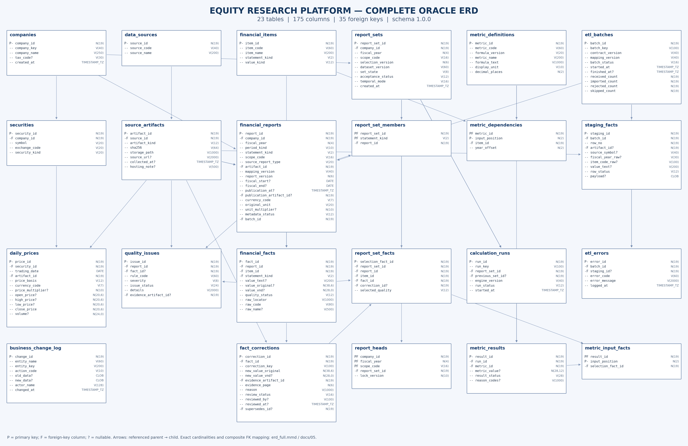

# Equity Research Platform — Oracle MVP

**Trạng thái 08/11/2026:** đã nhập và tính/lưu thật bộ FPT–HPG–VNM trên Oracle: 36 báo cáo, 132 số nguồn, 9 hiệu chỉnh, 12 snapshot; **9 run hoàn tất, 72 chỉ số VALID và 171 liên kết đầu vào**, tất cả khớp bộ chuẩn. Có 9 view chỉ đọc, ETL facade và 4 vai trò tài khoản (owner không đăng nhập, `ERP_APP`, `ERP_ETL`, `ERP_MONITOR`). **Đợt quản trị vận hành:** tablespace riêng `ERP_DATA` + quota, 4 policy unified audit + truy vấn giám sát, tối ưu đo trên 200× dữ liệu (Q1/Q4 nhanh ~25 lần), phục hồi logic bằng Data Pump và phục hồi vật lý bằng RMAN sau khi mất datafile. Kiểm thử: 10 audit, 38 phân quyền (chạy lại sau tối ưu), 39 calculation, 31 import, 21 cấu trúc, 13 Python đều đạt. ERD vẫn 23 bảng/175 cột/35 FK. **Database đã đủ cho 5 màn hình** (12 view, hàm sàng lọc PASS/FAIL/UNKNOWN; 15 ca API ứng dụng đạt). Phạm vi dữ liệu chốt 3 mã, chưa có giá ngày (ADR-29). Chưa có API/UI. **Đĩa máy còn ~1,2 GB (98%)** — xem rủi ro ở docs/11.

Đọc [PROJECT_MEMORY.md](PROJECT_MEMORY.md) để tiếp tục công việc. Review các lựa chọn quan trọng tại [31 quyết định thiết kế](docs/06_QUYET_DINH_CAN_REVIEW.md).

| Tài liệu | Nội dung |
|---|---|
| [Đặc tả MVP](docs/01_DAC_TA_MVP_ORACLE.md) | FR/NFR, phạm vi và nghiệm thu |
| [Contract và công thức](docs/02_HOP_DONG_DU_LIEU_VA_CHI_SO.md) | Dữ liệu, version, chất lượng, bộ 8 chỉ số |
| [Bộ mẫu đã đối chiếu](data/pilot_verified/README.md) | 12 kỳ, 132 giá trị đã review, 9 correction, 72 chỉ số hồi cứu |
| [Biên bản chốt dữ liệu](docs/07_KET_QUA_DOI_CHIEU_VA_CHOT_DU_LIEU.md) | Nguồn, đơn vị, scope, niên độ và kết quả kiểm tra |
| [ERD và giải thích](docs/04_THIET_KE_ERD.md) | Quan hệ, chuẩn hóa, snapshot/lineage và giới hạn |
| [Từ điển dữ liệu](docs/05_TU_DIEN_DU_LIEU.md) | Kiểu/NULL/PK/FK/UK/CHECK của 175 cột |
| [DDL](sql/001_schema.sql) | Script dựng 23 bảng và indexes |
| [Bằng chứng Oracle](evidence/oracle_verified_pilot/validation.json) | Phiên bản, schema, hash, kiểm tra và giới hạn |
| [Phân tích ứng dụng web](docs/13_PHAN_TICH_UNG_DUNG.md) | Phạm vi 5 màn hình, quy tắc hiển thị, yêu cầu phi chức năng, dữ liệu thực tế (đã duyệt) |
| [Kế hoạch ứng dụng web](docs/14_KE_HOACH_UNG_DUNG.md) | Kiến trúc, 11 API, giao diện, phiên bản, kiểm thử, các bước B0–B10 (chờ duyệt) |
| **[Hợp đồng dữ liệu cho ứng dụng](docs/12_HOP_DONG_DU_LIEU_CHO_UNG_DUNG.md)** | **Điểm vào cho backend/frontend**: kết nối, màn hình → view, cột, hàm sàng lọc, mã lỗi |
| [Quản trị vận hành](docs/11_QUAN_TRI_VAN_HANH_ORACLE.md) | Tablespace/quota, audit/giám sát, tối ưu trước–sau, Data Pump và RMAN phục hồi thật |
| [View và phân quyền](docs/10_VIEW_VA_PHAN_QUYEN_ORACLE.md) | 9 view, ETL facade, role/user, quy tắc chỉ số hiện hành, 38 ca kiểm thử |
| [Kết quả nhập Oracle](docs/08_NHAP_DU_LIEU_ORACLE.md) | Package, transaction, chống trùng, rollback, 31 kiểm thử và quyết định |
| [Bằng chứng nhập thật](evidence/oracle_import/validation.json) | Batch 132 số/9 hiệu chỉnh và đối chiếu đọc từ database |
| [Tính và lưu chỉ số](docs/09_TINH_VA_LUU_CHI_SO_ORACLE.md) | Package, 72 kết quả, 171 lineage, transaction và 39 ca kiểm thử |
| [Bằng chứng calculation](evidence/oracle_calculation/validation.json) | 9 run COMPLETED, kết quả và đầu vào đọc lại từ database |
| [View](sql/008_read_views.sql) · [ETL API](sql/009_etl_api.sql) · [Grants](sql/010_role_grants.sql) | 9 view chỉ đọc, package facade cho ETL, cấp quyền theo role |
| [Truy vấn demo APP](sql/011_demo_app_queries.sql) · [ETL](sql/012_demo_etl_status.sql) | Danh sách, chỉ số hiện hành, sàng lọc, lineage; trạng thái batch/run |
| [Bằng chứng phân quyền](evidence/oracle_access/validation.json) | Tài khoản/quyền thực tế trên ERP_DESIGN_V1, đối chiếu 72/171 khi đọc bằng ERP_APP |
| [Kiểm thử phân quyền](evidence/oracle_access_tests/validation.json) | 38 ca trên schema kiểm thử bằng đăng nhập thật |
| [SQL quản trị 013–017](sql/013_storage_tablespace.sql) | Tablespace, audit policy, role giám sát, truy vấn giám sát, index tối ưu |
| Bằng chứng quản trị | [lưu trữ](evidence/oracle_storage/validation.json) · [audit](evidence/oracle_audit/validation.json) · [hiệu năng](evidence/oracle_performance/comparison.json) · [phục hồi logic](evidence/oracle_backup_restore/logical_restore.json) · [phục hồi vật lý](evidence/oracle_backup_restore/physical_recovery.json) |

**ERD tổng thể:** [SVG](design/erd_full.svg) · [PNG](design/erd_full.png) · [PDF](design/erd_full.pdf)



[ERD chỉ số và ETL](design/erd_metrics_etl.png) · [Mermaid đầy đủ](design/erd_full.mmd)

Chạy kiểm tra từ thư mục gốc CSDL_HocSau:

```bash
python3 Quan_Tri_CSDL/scripts/prepare_pilot_review.py
python3 Quan_Tri_CSDL/scripts/build_verified_pilot.py
python3 Quan_Tri_CSDL/scripts/check_oracle_design.py --dataset Quan_Tri_CSDL/data/pilot_verified --evidence-dir Quan_Tri_CSDL/evidence/oracle_verified_pilot
python3 Quan_Tri_CSDL/scripts/check_oracle_import.py
python3 Quan_Tri_CSDL/scripts/import_verified_pilot.py
python3 Quan_Tri_CSDL/scripts/check_oracle_calculation.py
python3 Quan_Tri_CSDL/scripts/calculate_verified_pilot.py
python3 Quan_Tri_CSDL/scripts/check_oracle_access.py
python3 Quan_Tri_CSDL/scripts/deploy_oracle_access.py
python3 Quan_Tri_CSDL/scripts/check_oracle_app_api.py
python3 Quan_Tri_CSDL/scripts/check_oracle_audit.py
python3 Quan_Tri_CSDL/scripts/benchmark_oracle.py --label OPT
python3 Quan_Tri_CSDL/scripts/backup_restore_oracle.py --logical
python3 -m unittest discover -s Quan_Tri_CSDL/tests -v
```

Không sửa snapshot nguồn hoặc dữ liệu lịch sử. Không tự chạy DDL dựng mới lên schema có dữ liệu. Các runner dùng hai schema riêng thuộc dự án, không drop; migration ngày tải nullable và nâng guards được mô tả trong docs/08–09. Mật khẩu tài khoản APP/ETL sinh ngẫu nhiên, chỉ lưu ở `.local/` (đã gitignore), không ghi vào evidence. `deploy_oracle_access.py` mỗi lần chạy thêm một batch replay vào schema chính; `backup_restore_oracle.py --physical` đưa `ERP_DATA` offline vài giây. Việc ưu tiên tiếp theo: xử lý dung lượng đĩa/archive log, rồi làm API/UI theo docs/12.
