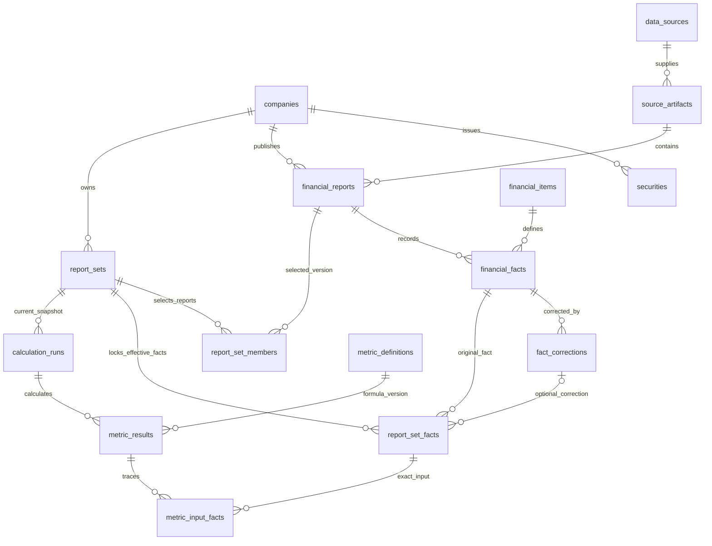

# Thiết kế ERD Oracle — phiên bản 1.0.0

Ngày 07/11/2026. **Đã tạo và kiểm chứng trên Oracle thực tế trong schema riêng ERP_DESIGN_V1**: 23 bảng, 175 cột, 35 khóa ngoại; trigger/package biên dịch không lỗi; 72 phép tính khớp baseline v2; 21 kiểm tra cấu trúc/biên và rollback fixture đạt. Chưa hoàn thành ETL, phân quyền vận hành, API hoặc giao diện.

**Cập nhật sau nhập pilot:** đã có package nhập liệu và 36 báo cáo/132 số nguồn/9 hiệu chỉnh/12 snapshot trong Oracle; 31 ca integration đạt. Mô hình không đổi số bảng/cột/FK; riêng `source_artifacts.collected_at` cho phép NULL nếu thiếu dấu thời gian tải, đồng bộ DDL/dictionary/ERD. Chi tiết [kết quả nhập](08_NHAP_DU_LIEU_ORACLE.md). Chưa có package điều phối lưu metric result hoặc quyền vận hành.

**Trạng thái hiện hành sau calculation:** đã lưu 9 run/72 metric result VALID/171 input lineage, đối chiếu khớp chuẩn; 39 ca integration và 21 smoke checks cấu trúc chạy lại đạt. Ba guard calculation được nâng để khóa parent và bảo vệ finalize, vẫn 14 trigger; có 3 package VALID, 0 compile errors. Chi tiết [tính và lưu chỉ số](09_TINH_VA_LUU_CHI_SO_ORACLE.md). View/roles và quyền vận hành còn triển khai; mô hình bảng không đổi.

## 1. Mở sơ đồ

**Một bản tổng thể đủ 23 bảng, 175 cột, 35 FK:** [SVG phóng to](../design/erd_full.svg) · [PNG](../design/erd_full.png) · [PDF](../design/erd_full.pdf).


- [ERD đầy đủ — Mermaid](../design/erd_full.mmd): đủ 23 bảng và 35 FK; hiển thị đủ 175 cột và ký hiệu PK/FK. Kiểu Oracle chi tiết nằm trong ảnh tổng thể và từ điển.
- [Sơ đồ tài chính và snapshot — SVG](../design/erd_financial.svg), [PNG](../design/erd_financial.png).
- [Sơ đồ chỉ số và ETL — SVG](../design/erd_metrics_etl.svg), [PNG](../design/erd_metrics_etl.png).
- [Từ điển dữ liệu](05_TU_DIEN_DU_LIEU.md): đủ 175 cột, kiểu, NULL, default, PK/UK/FK/CHECK.
- [Mô hình máy đọc](../design/schema_model.json) và [DDL](../sql/001_schema.sql).

Hai ảnh SVG/PNG là sơ đồ tổng quan, mũi tên từ bảng cha đến bảng con; Mermaid là bản có cardinality. Một số bảng xuất hiện ở cả hai ảnh để nối ngữ cảnh, không phải bảng trùng trong database.

## 2. Luồng quan hệ cốt lõi



Mỗi report set DRAFT có 0–3 thành viên; khi FROZEN phải có đúng BS, IS, CF. Report set năm trước là quan hệ bổ sung của calculation_runs; không dùng dữ liệu hiện hành ngầm tại lúc đọc kết quả. Những cardinality phụ thuộc trạng thái được bảo vệ bằng trigger, không thể hiện hết bằng crow's foot.

## 3. Nhóm bảng và lý do tách

| Nhóm | Bảng | Vai trò |
|---|---|---|
| Doanh nghiệp/chứng khoán | companies, securities | Pháp nhân khác mã giao dịch; sàn đang lưu là sàn hiện tại |
| Nguồn/ETL | data_sources, source_artifacts, etl_batches, staging_facts, etl_errors | Raw bất biến, provenance, vùng nhận có thể chứa dữ liệu lỗi và batch log |
| Báo cáo/fact | financial_items, financial_reports, financial_facts, fact_corrections | Tách định nghĩa khỏi giá trị và correction có bằng chứng |
| Snapshot lựa chọn | report_sets, report_set_members, report_set_facts, report_heads | Chọn đúng report/fact/correction; dữ liệu cũ không đổi khi head chuyển |
| Chỉ số | metric_definitions, metric_dependencies, calculation_runs, metric_results, metric_input_facts | Phiên bản công thức, lần tính và lineage t/t−1 |
| Chất lượng/lịch sử | quality_issues, business_change_log | Lỗi còn mở và thay đổi lựa chọn; không thay database audit |
| Giá | daily_prices | Thiết kế sẵn, dataset chưa có; không ảnh hưởng công thức tài chính |

23 bảng phục vụ các quan hệ nguồn/phiên bản/lineage thực tế, không phải 23 màn hình hoặc 23 nghiệp vụ người dùng phải thao tác. Không thêm bảng ML trong lần này.

## 4. Khóa và các tình huống cần ngăn

- Company ID không phụ thuộc symbol. `securities(exchange_code,symbol)` duy nhất cho danh mục hiện tại; chưa giải quyết lịch sử đổi mã/sàn. Khi mở rộng phải thêm listing history, không diễn giải sàn hiện tại thành lịch sử.
- Report version phân biệt công ty, năm, loại kỳ, statement, scope, artifact, mapping và `report_version`. Thay metadata đã review thì tạo version mới; không update mất metadata của phiên bản cũ.
- Fact duy nhất `(report_id,item_id)`. FK kép report/statement và item/statement ngăn đưa chỉ tiêu IS vào BS. `statement_kind` trong fact là thuộc tính lan truyền khóa có chủ đích để cưỡng chế bằng FK.
- Correction tham chiếu fact gốc, PDF/hash/trang và giá trị mới. Correction hoàn toàn bất biến; muốn review nâng trạng thái tạo successor có `supersedes_id` cùng fact, không sửa bản đã được snapshot sử dụng. Không tự chọn correction có ID lớn nhất.
- Report set member chỉ nhận report cùng company/year/scope; phải đúng statement. Trigger khóa parent set trước thay đổi để phối hợp với freeze.
- Report set fact liên kết report là thành viên, fact đúng report/item và correction đúng fact bằng các FK kép. `selected_quality` giữ kết quả chất lượng tại thời điểm lựa chọn; đây là snapshot có chủ đích.
- Head có PK company/year/scope và FK kép đến set; một khóa chỉ có một head. Head chỉ trỏ FROZEN; update tăng lock_version. Package vận hành sau này phải dùng `WHERE lock_version=:expected` và kiểm tra SQL%ROWCOUNT để chống mất cập nhật; trigger tăng version một mình chưa thay thế kiểm tra optimistic lock.
- Calculation run khóa set t và t−1; trigger từ chối năm không liên tiếp hoặc khác company/scope. Không có set t−1 thì các chỉ số cần đầu kỳ phải trả MISSING_INPUT.
- Metric input phải đúng item và year_offset trong metric_dependencies, đúng snapshot hiện tại hoặc năm trước. Kết quả/đầu vào của run đã COMPLETED/FAILED không được sửa.

## 5. Chuẩn hóa và phần lưu sẵn

Danh mục doanh nghiệp, chứng khoán, nguồn, chỉ tiêu và công thức tách riêng để tránh lặp tên/ý nghĩa trên facts. `report_set_members` và `metric_input_facts` giải quyết quan hệ nhiều–nhiều. Có surrogate ID và business UK để vừa tham chiếu ngắn vừa chống nhập trùng.

Không tuyên bố mọi bảng đạt 3NF thuần túy: `financial_facts.statement_kind` là thuộc tính lan truyền phục vụ FK kép; `report_set_facts` lưu sự lựa chọn/chất lượng tại một phiên bản; `metric_results` lưu kết quả dẫn xuất để đối chiếu và sàng lọc. Chúng là các ngoại lệ có chủ đích. Quy tắc giữ nhất quán: FK kép, snapshot đóng băng, kết quả theo run bất biến, thay đầu vào/công thức thì tạo phiên bản/lần tính mới. Không cập nhật lại kết quả cũ theo nguồn mới.

Tiền nguồn giữ text và NUMBER(38,6); VND chuẩn hóa NUMBER(28,0) chỉ sau xác minh đơn vị. Ratio NUMBER(28,12). Raw và canonical khác nhau; không nhét số chưa xác minh vào value_vnd. So sánh nguồn trước chuẩn hóa không phải chứng minh tài chính đã đúng.

## 6. Toàn vẹn: đã làm và còn ở package nghiệp vụ

Đã có trong DDL/trigger: PK/UK/FK/CHECK/NOT NULL, tính bất biến, khóa snapshot, thành viên cùng kỳ/phạm vi, head version, năm trước chính xác, input lineage, VALID không được gắn trên snapshot chưa VERIFIED, audit thay đổi head.

**Còn phải triển khai trong package import/calculation trước khi dùng ứng dụng:**

1. Chính sách quarantine theo nhóm IS/BS/CF, kiểm tra cân đối với dung sai đơn vị, và phê duyệt scope/fiscal/unit có đủ bằng chứng.
2. Xác minh quy đổi VND không mất phần lẻ, giới hạn độ chính xác, khóa idempotency/hash/version và trình tự batch; log sống sau rollback nghiệp vụ.
3. Khi freeze VERIFIED, kiểm tra bộ trường bắt buộc đủ cho từng nghiệp vụ/chỉ số, không chỉ có ba report và một số selected facts. Trigger hiện chưa thay thế danh sách trường cần thiết của từng công thức.
4. Kiểm tra đủ input, chất lượng của cả snapshot t−1, trạng thái lỗi và completeness trước finalize run/VALID. `pkg_metric_math` hiện chỉ tính số học/guard, không tự truy cập hoặc duyệt snapshot.
5. Cấp quyền chỉ EXECUTE package cho ETL, view đọc cho app; tài khoản/schema owner không nằm trong luồng ứng dụng. Kiểm thử hai session thực tế, database audit, backup/recovery chưa làm ở đợt này.

Không công bố schema đã sẵn sàng production. Những phần trên được ghi riêng để tránh nhầm các smoke test hiện tại với nghiệm thu trọn luồng ETL.

## 7. Chạy lại

```bash
python3 Quan_Tri_CSDL/scripts/design_schema.py
python3 Quan_Tri_CSDL/scripts/render_erd.py
python3 Quan_Tri_CSDL/scripts/check_oracle_design.py
```

Generator schema dùng stdlib; render cần matplotlib (đã có trên máy), không gọi dịch vụ ngoài. Runner dùng Docker/sqlplus của container hiện có. Lần đầu tạo schema-only ERP_DESIGN_V1 trong FREEPDB1, quota 64 MB trên USERS; không có mật khẩu/login. Lần sau giữ bảng, biên dịch lại guards/math và chạy kiểm tra; không tự migrate hoặc drop schema. Nếu đổi mô hình bảng phải viết migration riêng hoặc dùng schema thử nghiệm mới.

Các fixture cấu trúc ghi nhãn SYNTHETIC và rollback hoàn toàn; các phép tính 72 kết quả chạy qua PL/SQL với literal từ baseline, chưa phải nhập 192 fact tài chính vào các bảng. Đã dùng SYSDBA để dựng/kiểm tra schema thử; **chưa phải bằng chứng phân quyền ứng dụng**. Schema THACSI và container có sẵn được giữ nguyên.

## 8. Nguồn kỹ thuật

Thiết kế PK/FK/UNIQUE/CHECK/NOT NULL theo [Oracle 26 SQL Reference — constraints](https://docs.oracle.com/en/database/oracle/oracle-database/26/sqlrf/constraint.html); cú pháp bảng/identity theo [CREATE TABLE](https://docs.oracle.com/en/database/oracle/oracle-database/26/sqlrf/CREATE-TABLE.html). Các quy tắc nghiệp vụ liên bảng nói trên là quyết định thiết kế của dự án; xem log thực thi trong `evidence/oracle_design/` để biết phần đã được thử.
